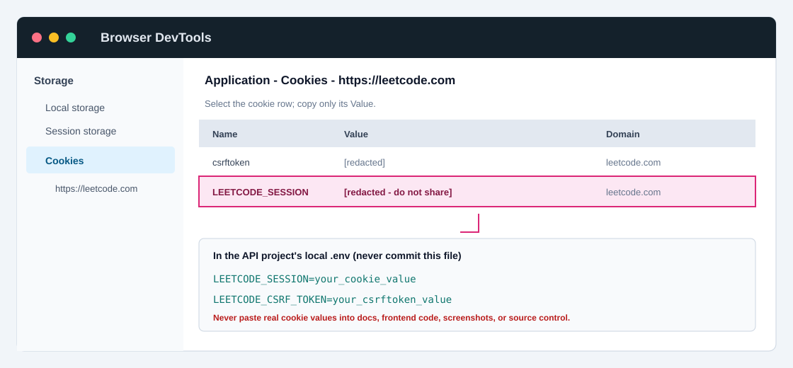

<h1 align="center">alfa-leetcode-api</h1>
<div align="center">

### The API for retrieving your LeetCode profile & Problems statistics


</div>

## About ✨

At First, I struggled to find proper documentation for the `leetcode.com/graphql`. After scouring various articles about the LeetCode public API, I still couldn't find the comprehensive documentation I was looking for. Fueled by the desire to fill this gap I created **alfa-leetcode-api**.

**alfa-leetcode-api** is a custom solution born out of the need for a well-documented and detailed LeetCode API. This project is designed to provide developers with endpoints that offer insights into a user's profile, badges, solved questions, contest details, contest history, submissions, and also daily questions, selected problem, list of problems.

## API URL 🌐

```
https://alfa-leetcode-api.onrender.com/
```

## Configure LeetCode Session Cookies (Local Development)

Some authenticated LeetCode endpoints need cookies from a LeetCode account that is allowed to view the submission. Keep these values on the API server only. Never put them in frontend code, commit them, or share them in screenshots, chat, logs, or issue reports.



1. Sign in to [leetcode.com](https://leetcode.com) in your browser using the account that can access the target submission.
2. Open DevTools (`F12` or `Ctrl+Shift+I`) and select **Application** (Chrome/Edge) or **Storage** (Firefox).
3. Open **Cookies** and select `https://leetcode.com`.
4. Find `LEETCODE_SESSION`, select it, and copy only its **Value**. Do not copy the cookie name, domain, or the complete cookie row.
5. If the endpoint requires it, find `csrftoken` in the same cookie list and copy only its **Value**.
6. In the `leetcode-api` project root, create your ignored local env file and set the values:

   ```bash
   # macOS / Linux
   cp .env.example .env
   ```

   ```powershell
   # Windows PowerShell
   Copy-Item .env.example .env
   ```

   Edit `.env` and replace the empty values. Keep each value on one line:

   ```dotenv
   LEETCODE_SESSION=paste_the_LEETCODE_SESSION_value_here
   LEETCODE_CSRF_TOKEN=paste_the_csrftoken_value_here
   ```

7. Restart the API after changing `.env`:

   ```bash
   npm run dev
   ```

8. Check `http://localhost:3000/auth/status`. It reports whether the session and CSRF values were loaded and may show the session username; it never returns the cookie values. Then retry the authenticated API operation.

The CSRF value is optional unless the request requires it. `/auth/status` confirms that environment values were loaded, but does not guarantee LeetCode still accepts the session. If the request remains unauthorized, sign in again, replace the expired cookie values, restart the API, and retry. In production, configure these as server-side secrets in the deployment platform rather than committing or placing them in a browser app.

**Security:** The screenshots used as the reference expose active LeetCode cookies. Treat those values as compromised: sign out/revoke that browser session (or change the account password if session revocation is unavailable), then capture fresh values. Never add the original screenshots to this repository.

## Run with docker 🐳

```
docker run -p 3000:3000 alfaarghya/alfa-leetcode-api:2.0.1
```

## Wanna Contribute 🤔??

follow this documentation => <a href="CONTRIBUTING.md" target="_blank">CONTRIBUTING.md</a>

### 💡 Rate Limit

I've implemented a rate limit to prevent any potential server overload issues.

### ‼️ Note

During development, it's recommended to utilize the API locally. To do so, follow this documentation => <a href="CONTRIBUTING.md" target="_blank">Local Deploy</a>

## Endpoints 🚀

### 👤User Details

| Details                       | Endpoint                             | Description                                                          | Demo                                                              |
| :---------------------------- | :----------------------------------- | :------------------------------------------------------------------- | ----------------------------------------------------------------- |
| _Profile_                     | `/:username`                         | Get details about a user's profile.                                  | <a href="./public/demo/demo2.png" target="_blank">click here</a>  |
| _Badges_                      | `/:username/badges`                  | Get the badges earned by the user.                                   | <a href="./public/demo/demo3.png" target="_blank">click here</a>  |
| _Solved_                      | `/:username/solved`                  | Get the total number of questions solved by the user.                | <a href="./public/demo/demo4.png" target="_blank">click here</a>  |
| _Contest_                     | `/:username/contest`                 | Get details about the user's contest participation.                  | <a href="./public/demo/demo5.png" target="_blank">click here</a>  |
| _Contest History_             | `/:username/contest/history`         | Get contest history.                                                 | <a href="./public/demo/demo6.png" target="_blank">click here</a>  |
| _Submission_                  | `/:username/submission`              | Get the last 20 submissions of the user.                             | <a href="./public/demo/demo7.png" target="_blank">click here</a>  |
| _Limited Submission_          | `/:username/submission?limit=number` | Get a specified **_number_** of the user's last submissions.         | <a href="./public/demo/demo8.png" target="_blank">click here</a>  |
| _Accepted Submission_         | `/:username/acSubmission`            | Get the last 20 accepted submission of the user.                     | <a href="./public/demo/demo16.png" target="_blank">click here</a> |
| _Limited Accepted Submission_ | `/:username/acSubmission?limit=7`    | Get a specified **_number_** of the user's last accepted submission. | <a href="./public/demo/demo17.png" target="_blank">click here</a> |
| _Calendar_                    | `/:username/calendar`                | Get the user's submission calendar.                                  | <a href="./public/demo/demo9.png" target="_blank">click here</a>  |

### 😀 New Endpoints 🎉

| Details                | Endpoint                                           | Description                          |
| :--------------------- | :------------------------------------------------- | :----------------------------------- |
| _Full Profile_         | `/userProfile/:username`                           | get full profile details in one call |
| _Year Calender_        | `/userProfileCalendar?username=yourname&year=2024` | get your calendar details with year  |
| _Lang Stats_           | `/languageStats?username=yourname`                 | get the language stats of a user     |
| _Question Progress_    | `/userProfileUserQuestionProgressV2/:userSlug`     | get your question progress           |
| _Skill Stats_          | `/skillStats/:username`                            | get your skill stats                 |
| _User Contest Ranking_ | `/userContestRankingInfo/:username`                | get contest ranking                  |
| _Trending Discussion_  | `/trendingDiscuss?first=20`                        | get top 20 trending discussions      |
| _Discussion Topic_     | `/discussTopic/:topicId`                           | get discussion topic                 |
| _Discussion Comment_   | `/discussComments/:topicId`                        | get discussion comments              |
| _Raw Daily Problem_    | `/dailyQuestion`                                   | get raw daily question               |

### ❓Questions Details

| Details                            | Endpoint                                                 | Description                                                                                                                  | Demo                                                              |
| :--------------------------------- | :------------------------------------------------------- | :--------------------------------------------------------------------------------------------------------------------------- | ----------------------------------------------------------------- |
| _Daily Problem_                    | `/daily`                                                 | Get the daily question.                                                                                                      | <a href="./public/demo/demo10.png" target="_blank">click here</a> |
| _Selected Problem_                 | `/select?titleSlug=selected-question`                    | Get details about a **_selected-question_**.                                                                                 | <a href="./public/demo/demo11.png" target="_blank">click here</a> |
| _Problems_                         | `/problems`                                              | Get a list of 20 problems.                                                                                                   | <a href="./public/demo/demo12.png" target="_blank">click here</a> |
| _Limited Problems_                 | `/problems?limit=number`                                 | Get a list of a specified **_number_** of problems.                                                                          | <a href="./public/demo/demo13.png" target="_blank">click here</a> |
| _Filter Problems_                  | `/problems?tags=tag1+tag2`                               | Get a list of problems based on selected **_tags_**.                                                                         | <a href="./public/demo/demo14.png" target="_blank">click here</a> |
| _Skip Problems_                    | `/problems?skip=number`                                  | Get a list of 20 problems, skipping a specified **_number_** of problems.                                                    | TODO                                                              |
| _Filter & Limited Problems_        | `/problems?tags=tag1+tag2+tag3&limit=number`             | Get a list of a specified **_number_** of problems based on selected **_tags_**.                                             | <a href="./public/demo/demo15.png" target="_blank">click here</a> |
| _Skip & Limited Problems_          | `/problems?limit=number&skip=number`                     | Get a list of a specified **_number_** of problems skipping a specified **number** of problems.                              | TODO                                                              |
| _Skip & Filter & Limited Problems_ | `/problems?tags=tag1+tag2+tag3&limit=number&skip=number` | Get a list of a specified **_number_** of problems based on selected **_tags_** skipping a specified **number** of problems. | TODO                                                              |

## Author ✒️

- [@alfaarghya](https://www.github.com/alfaarghya)

## Contributor ✏️

| Contributor                                        | Contribution                                                                     |
| :------------------------------------------------- | :------------------------------------------------------------------------------- |
| [@aryanpingle](https://www.github.com/aryanpingle) | AC submission                                                                    |
| [@jamesh48](https://www.github.com/jamesh48)       | TypeScript Refactoring                                                           |
| [@kvqn](https://www.github.com/kvqn)               | PORT environment variable                                                        |
| [@changchunlei](https://github.com/changchunlei)   | New Endpoints - language stats, integrated user profile, contest and discussions |
| [@merakesh99](https://github.com/merakesh99)       | Hot reload issue solved                                                          |
| [@ajchili](https://github.com/ajchili)             | Skip param to fetch problems                                                     |
| [@theinit01](https://github.com/theinit01)         | Temp fix for skip                                                                |
| [@123xylem](https://github.com/123xylem)           | Add Descriptions and Methods to API route documentation.                         |

## Connect with me 📲

[](https://linkedin.com/in/alfaarghya)
[](https://twitter.com/alfaarghya)
[](https://www.instagram.com/alfaarghya)
[](https://leetcode.com/alfaarghya/)
